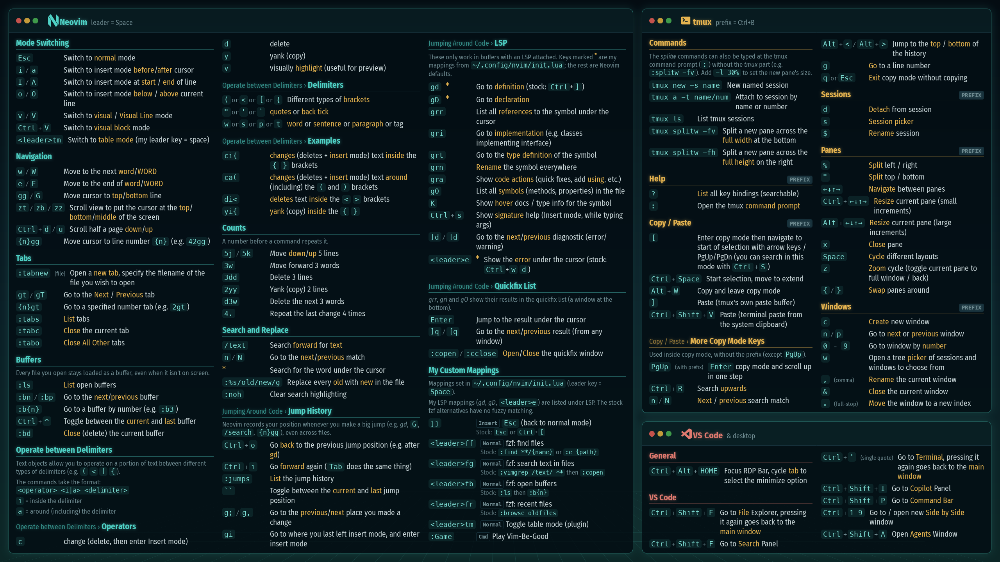

# Cheat Sheets

My personal keyboard shortcut cheat sheets for the tools I use every day, plus a script that turns them
into a desktop wallpaper so they're always in view.

| Cheat sheet | Covers |
|---|---|
| [NeoVim.md](NeoVim.md) | Modes, navigation, tabs, buffers, text objects, counts, search & replace, jumps, LSP, quickfix and my custom mappings |
| [Tmux.md](Tmux.md) | Commands, sessions, panes, windows, copy mode and help |
| [VSCode.md](VSCode.md) | Moving focus between VS Code panels, plus a remote desktop shortcut |

## Wallpaper

[](wallpaper/cheatsheet-wallpaper.png)

The wallpaper is generated from the three cheat sheets above. Download it at
[2560x1440](wallpaper/cheatsheet-wallpaper.png) or the sharper
[5120x2880](wallpaper/cheatsheet-wallpaper@2x.png) version.

### Rebuilding it

Rerun the script after editing any of the `.md` files. The font size is picked automatically so everything fits the screen.

```sh
python3 wallpaper/build.py            # writes cheatsheet-wallpaper.png and cheatsheet-wallpaper@2x.png into wallpaper/
python3 wallpaper/build.py <out dir>  # somewhere else
```

Requirements:
- Python 3 (standard library only)
- Firefox: used headless to render the page and take the screenshots
- Fonts: Fira Sans Condensed, MesloLGS Nerd Font

### How the markdown is read (`wallpaper/parse.py`)
- `##` / `###` headings become sections; `###` sections show their parent heading as a prefix.
- Table rows become key → description rows. The first column is the key. A `Mode` column becomes a small
  badge, and any further columns become a grey second line (e.g. "Stock: …").
- Text in backticks: plain words (`` `normal` ``) are highlighted, anything else (`` `Ctrl`+`V` ``, `` `:noh` ``) is shown as a key.
- Paragraphs shaped like `` `key` to do something `` become rows; other paragraphs become notes.
- tmux sections listed in `TMUX_PREFIXED` get a PREFIX tag; `FIXES` corrects typos on the wallpaper only.

Colours live in `THEME` at the top of `wallpaper/build.py`.
